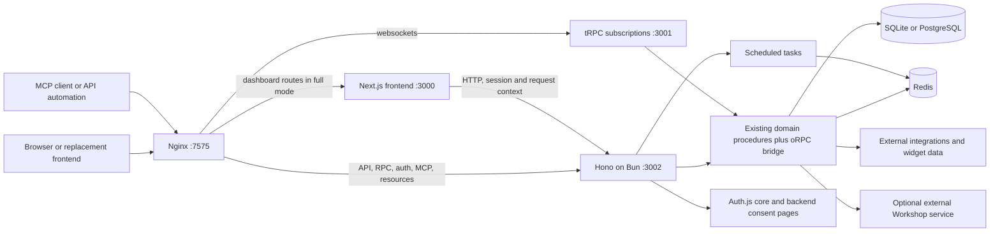

# Homarr headless backend migration report

Date: 2026-10-16. Branch: `feat/headless-hono-backend`. Baseline: `dc2662d9f2eaabf9b7ba14693f8ddda8a56aeeff`.

## Result and scope

Homarr's backend now has an independently runnable Hono application on Bun, with oRPC v2 beta alongside the existing tRPC, REST/OpenAPI, MCP, authentication, and resource endpoints. The existing dashboard consumes the backend through HTTP. The headless Docker target omits the dashboard build and starts no Next.js process.

This work extracts the existing backend endpoint by endpoint. It reuses the integration clients, widget-data handlers, database schema, permission middleware, caches, jobs, and business procedures. It does not replace those capabilities with a small demonstration server.

The local implementation is validated with fresh headless and full Docker images, SQLite and PostgreSQL startup, authenticated HTTP/RPC, real backup restore/restart, and browser checks. The headless image contains no Next application or React/Next runtime packages. Nothing here claims a published image, merged pull request, release, or production deployment.

The continuous work log is [scratchpad.md](scratchpad.md). The complete baseline route ledger and acceptance requirements are in [inventory.md](inventory.md); upstream API decisions are in [architecture-research.md](architecture-research.md).

## Runtime architecture



The subscription listener and scheduled tasks run under backend ownership. The diagram shows their responsibilities separately; they do not require separate application containers. Headless mode removes the Next frontend branch. Full mode retains the existing dashboard behind the same public origin.

The source listener defaults to `0.0.0.0:3002`. Docker binds it to loopback and exposes Nginx on 7575, retaining trusted client-identity forwarding. Exposing the internal listener through an untrusted proxy would change that trust boundary.

## Ownership before and after

| Responsibility            | Original Next coupling                                       | Migrated owner                                                                 |
| ------------------------- | ------------------------------------------------------------ | ------------------------------------------------------------------------------ |
| HTTP transport and routes | App Router `route.ts`, `NextRequest`, `NextResponse`         | Hono route groups with standard Fetch requests/responses                       |
| Domain procedures         | Shared tRPC routers hosted by Next                           | Same router implementations hosted by Bun, also exposed through oRPC           |
| Resource endpoints        | Backup, media, health and authoring handlers in the Next app | `packages/backend-handlers`                                                    |
| Authentication            | NextAuth configuration, ambient headers/cookies              | Auth.js core with explicit request and response-cookie adapters                |
| MCP and OAuth             | Next route/helper graph and React consent page               | `packages/api/src/http/mcp`, backend consent HTML and dashboard state endpoint |
| Assistant                 | Large Next route with app aliases and component contracts    | `packages/api/src/http/assistant` and shared contracts                         |
| Server-rendered reads     | Direct database/auth/Redis access in RSC paths               | Authenticated HTTP clients and backend `frontend` context procedures           |
| Jobs and subscriptions    | Next production instrumentation                              | Backend entrypoint and lifecycle                                               |
| Locale strings            | `next-intl/server` request context                           | Neutral HTTP translation entrypoint; frontend retains its own localization     |
| Cache invalidation action | `revalidatePath` server action                               | Remains a dashboard presentation operation                                     |

The backend no longer obtains React hooks or Mantine theme code through the common utility barrel. Those exports have explicit UI entrypoints. Stock-price input enums moved into definitions so the API does not import a widget component graph just to obtain ranges and intervals.

The dashboard still renders pages, localizes its UI, performs presentation redirects, and manages its page cache. Persisted state, integration credentials, actual authorization, mutations, and background work belong to the backend.

## Endpoint and procedure coverage

The baseline contains 26 HTTP route files: 25 API route files plus the well-known handler. All are covered by the Hono composition or the corresponding extracted handler. Next route entrypoints are forwarding adapters, preserving requests and streamed responses for existing dashboard URLs.

| Surface                       | Backend entrypoint or owner                                                                    |
| ----------------------------- | ---------------------------------------------------------------------------------------------- |
| New typed RPC                 | `POST /rpc/<namespace>/<procedure>`                                                            |
| Existing typed dashboard API  | `/api/trpc/<namespace>.<procedure>`                                                            |
| Existing REST API and schema  | Existing `/api/*` paths and `/api/openapi`, including Scalar normalization                     |
| Authentication                | `/api/auth/*`, including native sign-in, CSRF, providers, callbacks, session and sign-out      |
| MCP and OAuth                 | `/api/mcp`, transport aliases, authorization, registration, token and consent state            |
| Discovery and browser consent | `/.well-known/*`, `/well-known/*`, transport discovery alias, `/auth/mcp` and error page       |
| Onboarding                    | Claim endpoint and existing onboard/user/group procedures                                      |
| Resources                     | Health, backup, media, image proxy, authoring resources, configuration requests and about data |
| Assistant                     | `/api/assistant/chat`                                                                          |

The recursive runtime inventory resolved **346 current procedure paths** and found exact tRPC-to-oRPC path parity, including the new frontend context namespace. This verifies registration and successful imports. It does not mean every procedure has been executed against a real upstream integration.

The baseline [inventory](inventory.md) lists all HTTP routes, 27 original root namespaces, 46 widget subrouters, and the four subscription behaviors. Its 337 static procedure declarations are a different measurement from the current resolved runtime inventory. The backend added nine presentation-context procedures formerly implemented as direct frontend reads.

MCP still uses its eager tool composition and enabled-tool filtering. REST retains its curated OpenAPI composition. Their permission and exposure rules are not replaced with indiscriminate publication of every procedure.

## oRPC v2, compatibility, and future clients

The implementation pins oRPC to `2.0.0-beta.44` and Hono to `4.13.13`. Hono mounts oRPC's Fetch handler; the router is converted through the first-party `@orpc/trpc` adapter. This retains existing validation, middleware, and lazy router behavior while removing Next as the backend host. [Hono adapter](https://orpc.dev/docs/adapters/hono), [tRPC integration](https://orpc.dev/docs/integrations/trpc).

The new oRPC endpoint is POST-only, including reads. This prevents a browser GET from invoking a converted mutation. Legacy tRPC retains its query/mutation method rules. Both transports accept the existing database session or supported API key; unsafe cookie-authenticated requests enforce origin checks.

Three callback-based subscriptions were adapted to async iterators: logs, cron status, and Docker logs. The adapter handles cancellation during a pending read, completion, errors, and exactly-once source teardown. The Beszel stream already uses an async generator. Docker stream initialization also checks whether the subscriber disconnected before initialization finished.

Procedure definitions remain authored with tRPC builders. This is a complete hosting boundary extraction with a new oRPC interface, not a claim that tRPC source dependencies disappeared. A later native oRPC conversion can replace builders and metadata incrementally while keeping the same domain services. [Native migration guide](https://orpc.dev/docs/migrations/from-trpc).

Two compatibility details matter for a new frontend:

- Existing REST metadata remains served by `trpc-to-openapi`; the REST document does not automatically describe every new RPC path.
- Existing custom tRPC validation/domain-error data remains on the legacy endpoint. The new bridge supplies oRPC codes/messages; rich typed error data needs an explicit native contract.

A separate TypeScript client can import only the exported client type:

```ts
import { createORPCClient } from "@orpc/client";
import { RPCLink } from "@orpc/client/fetch";
import type { ORPCClient } from "@homarr/api/orpc";

const client = createORPCClient<ORPCClient>(
  new RPCLink({
    url: `${process.env.HOMARR_BACKEND_URL}/rpc`,
    headers: { ApiKey: process.env.HOMARR_API_KEY! },
  }),
);

const info = await client.info.getInfo();
```

That example is a server-side/service client. A browser should use the supported session flow and credentialed Fetch; it should not receive a server's API key or encryption secrets. [Client API](https://orpc.dev/docs/client/client-side).

oRPC is separate from gRPC. A future gRPC endpoint would need an explicit service/message contract and corresponding transport, commonly `.proto` definitions and generated clients. The extracted services make that possible, but this migration does not implement protobuf/gRPC. [gRPC introduction](https://grpc.io/docs/what-is-grpc/introduction/).

## Authentication, MCP, and assistant behavior

Authentication uses the existing database adapter, credential/LDAP checks, OIDC profile mapping, account-linking safeguards, group synchronization, and permission enrichment through Auth.js core. Backend sign-in supplies its own minimal CSRF-aware HTML form and does not require React or a dashboard server. Existing cookie names and database-session behavior remain supported.

Direct request-session lookup validates the database token and permissions; it does not extend expiry. `/api/auth/session` retains Auth.js renewal behavior and response cookies. A separate frontend must forward all response cookies rather than retaining only one `Set-Cookie` value. [Auth work log](auth.md), [Auth.js core reference](https://authjs.dev/reference/core).

MCP keeps tools, resources, prompts, safe errors, scoped API-key/bearer authentication, rate limits, one-time codes, S256 PKCE, browser/session binding, and explicit consent. Backend-owned consent includes the account, client callback, effective permissions, administrator warning, and credential-lifetime information. The dashboard obtains consent state over HTTP instead of owning pending grants.

OAuth registrations and pending grants remain process-local as before. Multiple independent replicas would require shared grant storage and coordination; a single independently runnable backend is the supported topology established here.

The assistant retains streaming, persisted threads, tool approvals, Custom Widget lifecycle policy, provider options, request limits, timeouts, cancellation, and telemetry. Its locale strings load through the neutral translation package, without Next request context. Loopback model fixtures verify transport behavior; they do not establish compatibility with every external AI provider. [MCP/assistant work log](mcp-assistant.md).

Workshop remains an optional separate Go/PocketBase service. Its Homarr-side client and operations remain available when configured. Integration brokering, ordinary widget data, and MCP do not require embedding Workshop's server into the headless container.

## Bun database and native dependency work

The existing `DB_DRIVER=better-sqlite3` selection and SQLite file format remain compatible. On Bun, the shared driver chooses `bun:sqlite` and Drizzle's Bun adapter. On Node, migrations and the administration CLI retain `better-sqlite3`. This avoids loading a V8-only SQLite binding into Bun. PostgreSQL retains its existing driver path.

Runtime probes found behavior differences that a simple port would miss: Bun initially disabled foreign keys and used a zero busy timeout. Every migrated Bun connection now enables foreign keys and sets `busy_timeout=5000`, including read-only connections. Cascades, nullable foreign-key updates, orphan rejection and lock waiting were checked. Bun insert/update metadata is retained for conditional writes and onboarding races.

Backup export uses parameterized `VACUUM INTO` through the shared driver. A read-only WAL checkpoint was incompatible with Bun; a live-writer fixture confirmed the snapshot includes committed WAL data without changing the source database. Restore keeps archive bounds, migrations, encryption-key handling, temporary-file cleanup, locking and process restart. ZIP backup remains SQLite-only.

SSH dependencies exposed another runtime boundary: ssh2's optional native crypto/CPU-feature accelerators could crash Bun. An exact-version patch skips those accelerators on Bun and keeps its JavaScript crypto implementation. Node retains the existing acceleration path. A complete remote SSH integration workload remains separate from proving that the backend can import/start safely.

Details and upstream references: [Bun database work log](bun-database.md), [Bun SQLite](https://bun.com/docs/runtime/sqlite), [Drizzle Bun SQLite](https://orm.drizzle.team/docs/sqlite/connect-bun-sqlite).

## Packaging and container lifecycle

`scripts/assemble-backend.mjs` assembles an ESM server with esbuild, executed by Bun. Bun 1.4.2's bundler emitted invalid namespace references around external `export *` declarations in the inspected graph; switching the assembler avoided changing the runtime or rewriting those dependencies. [esbuild API](https://esbuild.github.io/api/).

Native modules and packages that read adjacent files remain external with their required package layouts. The assembler copies their dependency closure, retaining nested incompatible versions instead of flattening everything. Isolated artifact execution exposed a nested undici-version issue that running inside the checkout concealed; external version placement was corrected accordingly.

The assembler emits a size metafile and rejects emitted Next, React and Mantine inputs. The package also includes migration assets, SQL WASM, generated dependency metadata, authoring catalogs and locale strings. It does not copy the entire monorepo `node_modules` into the headless image.

| Docker target    | Included application runtimes                                                                 |
| ---------------- | --------------------------------------------------------------------------------------------- |
| `backend`        | Bun backend, subscriptions and tasks; Nginx; optional internal Redis; Node for CLI/migrations |
| Default `runner` | Same backend plus the traced Next dashboard server                                            |

The backend builder has no dependency on the frontend build stage. Both targets keep `/appdata`, trusted certificates, `_FILE` variables, PUID/PGID handling, migration failure checks and optional external Redis. Explicitly supplied `AUTH_SECRET` is preserved.

Startup binds the backend, initializes jobs and subscriptions, and reports readiness only after startup completes. The existing live endpoint checks DB and Redis. SIGTERM removes readiness and stops jobs/ingress/processes. A clean backend exit requested by backup restore restarts only Bun, preserving Nginx, Redis and the frontend. This works without a Docker restart policy. Unexpected backend failures or ancillary-service exits stop the group and return failure so a configured container restart policy can recover it.

## Size and resource findings

Removing Next does not automatically produce a tiny service broker. The full backend retains integration SDKs, parsers, sanitization, databases, authoring data, authentication, streaming, and background caches. Node remains for the existing administration/migration tools; Redis and Nginx remain in the default container composition.

The following is a **local assembled-artifact snapshot**, not Docker image size, compressed registry transfer size, or memory usage. File bytes were read from the current `apps/backend/build` output; later builds can change them.

| Category                                 | Observed bytes | Interpretation                                         |
| ---------------------------------------- | -------------: | ------------------------------------------------------ |
| Minified server JavaScript               |     19,933,434 | About 19.0 MiB; includes bundled code and data         |
| External runtime package files           |     72,726,002 | About 69.4 MiB; includes package source/support files  |
| SQL WASM asset                           |        659,730 | About 0.63 MiB                                         |
| Build attribution metadata               |      2,603,283 | About 2.48 MiB; diagnostic file                        |
| Translation input contribution to JS     |     11,164,508 | About 56% of emitted JS; already included in first row |
| Kubernetes SDK contribution to JS        |      1,366,006 | Already included in first row                          |
| Custom Widget package contribution to JS |        963,635 | Already included in first row                          |

The final local Linux amd64 Docker images were measured with `docker image inspect`:

| Image                    | Uncompressed bytes |   MiB |
| ------------------------ | -----------------: | ----: |
| Headless backend         |        353,019,421 | 336.7 |
| Full dashboard + backend |        545,415,132 | 520.1 |

The backend target is **35.3% smaller** than the full target built from the same implementation. This compares the two new targets, not the previously published Homarr image, and does not measure registry-compressed transfer size. Immutable local IDs:

- Backend: `sha256:ab48932b41c3cfe0b0ee50601b475e1ffc1ffb9013dcc7fcf11d0c051537e9f0`.
- Full: `sha256:8a8c10269c5b57a19884016a5ac7b9cefb8eb878a88408affcae5ee68687a40b`.

Within the headless container, allocated file sizes from `du -sk` are approximately 122.6 MiB for the Node binary, 70.1 MiB for Bun, 103.1 MiB for the assembled backend directory, 10.8 MiB for migration files, 2.6 MiB for the CLI bundle and 2.3 MiB for the separately staged SQLite binding. These are diagnostic filesystem measurements, not independent compressed layers. Retiring the Node operational runtime after a separate CLI/migration migration is a significant future size opportunity.

One post-smoke Docker memory sample was 297.9 MiB for the headless container. It is neither a controlled settled-idle measurement nor a peak, and does not establish a memory reduction against the full image.

The external package snapshot includes roughly 12.5 MB for better-sqlite3, 10.4 MB for Drizzle, 9.5 MB for ssh2 and 8.9 MB for jsdom. These are package file sums, not their incremental Docker-layer costs. The headless container additionally includes runtimes, operating-system packages, CLI and migration bundles.

The largest identified bundled-data opportunity is HTTP translations: the full locale catalogs currently enter the artifact so backend consent/errors remain localized. A later build could extract only the backend-used message namespaces. External-package pruning could remove unused declarations/maps/build sources, after verifying package runtime lookup requirements. Neither optimization should remove security checks or supported integration behavior.

Memory and CPU need matched measurements: identical database/integrations/jobs, same Redis placement and architecture, settled idle windows, then representative refresh, MCP, assistant and backup workloads. Large ZIP restore limits mean peak memory can be substantially greater than idle RSS. Framework microbenchmarks cannot predict these costs. [Comparison context](https://orpc.dev/docs/comparison).

## Frontend independence and first paint

The current frontend accepts `HOMARR_BACKEND_URL`, defaulting to `http://127.0.0.1:3002`. API requests and RSC reads cross HTTP; the frontend no longer needs database credentials, Redis access, encryption keys, Auth.js secrets, or identity-provider credentials. Runtime UI capabilities and authenticated sessions come from backend endpoints.

Manual startup used an empty frontend environment containing only process essentials, the backend URL, development mode and telemetry settings. `/init`, `/auth/login`, health, frontend-routing tRPC, discovery and oRPC requests returned 200 through that frontend. A browser signed in, opened the seeded dashboard, rendered widgets, entered/saved board edit mode and reloaded without browser errors. The final full Docker image also completed the entire fresh browser onboarding flow, including claim, administrator creation, authenticated setup and board construction, without browser errors or the redirect loop found during integration; restoring the original `HOSTNAME=0.0.0.0` bind preserved internal locale rewrites.

One optimization changed deliberately: frontend RSC cross-request Redis board snapshots were removed. Backend integration caches remain, and server rendering still prefetches widget data over HTTP. First paint may therefore wait for those backend requests. Restoring shared snapshots should use a backend-owned generator; allowing browsers to submit shared widget-cache content would let one viewer affect another viewer's data. [Frontend work log](frontend-boundary.md).

## Launch and first-use instructions

Use the pinned toolchain with `mise exec --`. Configure the existing repository `.env` with persistent auth/encryption secrets, the intended database and Redis settings, and the actual public `BASE_URL`. Retain the original encryption key when using an existing database. No new configuration file containing sample credentials is required.

From the repository root, source development uses separate backend/frontend processes:

```sh
mise exec -- bun run docker:dev:up
mise exec -- bun run db:migration:sqlite:run
mise exec -- bun run dev:backend
```

The migration command applies migrations, seed and custom migration work to the configured development database. For a PostgreSQL configuration, use the existing PostgreSQL migration command instead. The backend start command is `mise exec -- bun run start:backend`; `mise exec -- bun run build:backend` assembles its independent artifact.

Run the existing dashboard separately with `HOMARR_BACKEND_URL` pointing at that backend. For a consistent local development hostname, use:

```sh
HOMARR_BACKEND_URL=http://127.0.0.1:3002 mise exec -- bun run --filter @homarr/nextjs dev --hostname localhost
```

The consistent hostname avoids the observed Next development locale-rewrite loop. A replacement frontend can instead call oRPC/REST/MCP directly. Set `BACKEND_CORS_ORIGINS` to exact allowed origins when credentialed browser requests cross origins; server API keys remain outside browser bundles.

The headless Compose recipe builds the backend target and persists `/appdata`:

```sh
docker compose --env-file .env -f deployments/headless/compose.yml up --build -d
curl --fail http://localhost:7575/api/health/ready
docker build --target backend -t homarr:backend .
docker build -t homarr:full .
```

For a fresh database without the dashboard, retain one cookie jar/session through the existing setup protocol: `POST /api/onboarding/claim`, inspect `onboard.currentStep`, call `onboard.nextStep`, then `user.initUser` for credentials setup. External-auth setup uses the existing initial group procedure when the step requires it. Sign in through `/api/auth/signin`, then submit `onboard.completeSetup` using its existing typed schema. API-key creation remains the authenticated `apiKeys.create` operation. The backend supplies these capabilities; it does not add a new graphical onboarding wizard.

For administrator recovery on an existing installation with credentials enabled, the existing CLI is available:

```sh
docker compose --env-file .env -f deployments/headless/compose.yml exec backend homarr recreate-admin --username admin
```

That command refuses to create another credentials administrator when one already exists and prints a generated temporary password. It is an administration/recovery path, not a replacement for completing fresh onboarding.

## Validation evidence and external coverage limits

Validation used isolated SQLite/Redis fixtures and synthetic users/credentials. No new test files were added. Existing relevant tests were adjusted to import the extracted owner and run by exact file.

| Area                          | Recorded evidence                                                                                                                                                                                                         |
| ----------------------------- | ------------------------------------------------------------------------------------------------------------------------------------------------------------------------------------------------------------------------- |
| Router registration           | 346 recursively resolved paths, exact current tRPC/oRPC parity                                                                                                                                                            |
| RPC manual fixture            | Public/protected procedures, nested widget lazy import, API key/session auth, REST key-only behavior, schema, origin checks, mutation-method rejection, log/cron SSE and cancellation                                     |
| Subscription adapter          | Delivery, pending-read cancellation, completion/error forwarding, exactly-once teardown; existing log regression: 1 file, 1 passing test                                                                                  |
| Resource endpoints            | Static JSON/WASM, admin denials, schema/token 404, SVG sanitization/304/CSP, claim lock/security cookie, backup ZIP/413, healthy DB/Redis, proxy bytes/errors                                                             |
| Existing resource specs       | Exact administrator helper, configuration-request and backup-import files: 23 passing tests                                                                                                                               |
| Existing REST/proxy specs     | Six REST/CORS and eight locale/onboarding proxy cases pass; 109 passing cases across all eight changed existing spec files                                                                                                |
| Existing MCP/OAuth specs      | Transport: 18 passing tests; OAuth flow: 53 passing tests                                                                                                                                                                 |
| MCP manual fixture            | 22 core checks plus 23 HTTPS-proxy-flow checks, including real issued bearer token, initialize/list/call, PKCE, replay and consent-origin checks                                                                          |
| Assistant manual fixture      | Seven stream properties, persistence/telemetry, sanitized upstream error, cancellation/provider abort and subsequent recovery, using a loopback model                                                                     |
| Auth fixtures                 | Node and Bun login/CSRF, bad password, cookie security, lookup/expiry, renewal and sign-out revocation                                                                                                                    |
| SQLite fixtures               | Node/Bun file roundtrip and integrity, transactions, insert metadata, WAL snapshot, foreign keys and contention waiting; Node compiled migrations                                                                         |
| PostgreSQL container          | PostgreSQL 17 Alpine, fresh migration/seed, Bun readiness/live health, oRPC read, claimed onboarding mutation, application restart and persisted state                                                                    |
| Headless container            | Fresh volume; ready/live, oRPC, tRPC, OpenAPI, resources/WASM, Auth.js credentials, MCP challenge, CORS/preflight, WebSocket upgrade; no Next process/application or UI packages                                          |
| Container persistence/restore | PUID/PGID 1000, graceful stop and volume reuse; real authenticated backup export/import succeeds, Bun restarts, original session survives; Nginx/Redis and container start time remain unchanged with restart policy `no` |
| Full container                | Final production image builds and starts both backend and Next; health/RPC and complete fresh browser onboarding pass; IP/DNS/locale routes checked                                                                       |
| Frontend boundary             | Secretless frontend startup plus manual proxy streaming/query/redirect/multiple-cookie checks                                                                                                                             |
| Static/package checks         | Focused package TypeScript/lint/format checks reported by owners; shell/assembler syntax and Compose configuration checks                                                                                                 |
| Import boundary               | Final source AST audit: 806 workspace modules, zero framework/UI runtime edges or client directives; assembly rejects emitted frontend modules                                                                            |

Final focused backend and Next TypeScript checks, selected-file lint/formatting, lockfile parity (`bun install --frozen-lockfile`), MDX compilation/local documentation links and `git diff --check` pass. No broad monorepo test, integration-service matrix, or E2E suite was run.

Live LDAP/OIDC callbacks, every external integration, real remote Docker/SSH providers, multiarchitecture deployment and real external model providers were not established by the synthetic checks. Those limits do not erase the verified transport work, but they must remain explicit when deciding deployment readiness. See the [acceptance checklist](inventory.md#acceptance-checklist) for the full completion contract.
