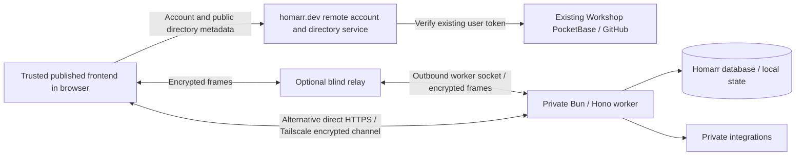

# Homarr headless worker and remote frontend

Implementation and local acceptance report, 2026-10-16. Work is isolated on `feat/headless-hono-backend` at `/home/habs/.codex/worktrees/headless-hono/homarr`, based on `dc2662d9f2eaabf9b7ba14693f8ddda8a56aeeff`. The original checkout was preserved. Nothing has been committed, pushed, published or deployed by this work.

## Result and scope

Homarr can run as an independent Bun/Hono worker. The canonical application backend is native oRPC v2 beta, with existing domain handlers, database schemas, integration clients and authorization reused. The worker does not start Next.js or require a frontend, Node, Redis server or Nginx. A separate TanStack Start frontend and Hono account service can connect directly or through an optional blind relay.

The hosted account service reuses the existing Workshop PocketBase `users` collection and its configured GitHub provider, as requested. Deployment files mount it at `https://homarr.dev/remote/` while preserving the main website and PocketBase routes. A second GitHub application or identity system is not needed. Live GitHub/PocketBase login and deployment were explicitly excluded by the user; all reported acceptance is local.

The new frontend is a working connection/access console and read-only board viewer. It exposes pairing, remembered devices, connection settings, invitations, account-directory membership, shares and encrypted media. It does not recreate the original dashboard editor or every widget's visual/interactive behavior. Owners can use the full native backend APIs through encrypted clients. The existing Next dashboard is retained as a separate optional compatibility consumer.

## What changed

| Area            | Before                                                | Implemented result                                                                                                                      |
| --------------- | ----------------------------------------------------- | --------------------------------------------------------------------------------------------------------------------------------------- |
| Application API | tRPC-authored procedures, Next-oriented consumers     | Native oRPC procedures; 346 original paths/kinds/schema counts preserved; 2 deliberate safe widget queries added, total 348             |
| HTTP handlers   | Next route implementations                            | Framework-independent handlers plus Hono routing for REST, MCP, Assistant, backup, media, onboarding, health and Custom Widget requests |
| Worker runtime  | Previous backend image included Node, Nginx and Redis | Bun worker with direct HTTP/WebSocket listener, Bun migrations/CLI and local state                                                      |
| Worker ingress  | Conventional HTTP authentication                      | Health-only public HTTP; all application requests require paired encrypted device access                                                |
| Remote frontend | Original Next dashboard coupled to its deployment     | Independent TanStack Start SPA; can be hosted with the metadata service or as static assets                                             |
| Identity        | Worker-local dashboard login                          | Existing Workshop PocketBase/GitHub identifies platform accounts; worker independently owns device grants                               |
| Connectivity    | Direct dashboard/backend route                        | Explicit direct HTTPS/Tailscale connection or outbound worker connection to a blind relay                                               |
| Sharing         | Existing application access                           | Device-bound invitations; scoped temporary/permanent shares; anonymous or approved-member-only access; active revocation/expiry         |
| State/cache     | Redis-backed runtime                                  | Bounded local cache, Pub/Sub, locks and atomic operations; external Redis remains opt-in                                                |

The native API migration replaced the authoring/execution boundary rather than wrapping a tRPC server. `packages/api/src/procedure.ts` builds real native oRPC procedures, and native lazy routers retain domain loading boundaries. MCP walks native contracts and keeps its reviewed 133-tool allowlist. Native REST retains its explicit 42 paths / 52 operations, with schema generation, query coercion and parameterless procedure handling.

The old dashboard's tRPC hooks use only `@homarr/api/legacy`. That adapter delegates to the same native handlers and is enabled explicitly in the full dashboard image. Worker assembly rejects emitted tRPC/bridge/Next/React/Mantine dependencies. Merely installing compatibility packages in the monorepo does not put them in the worker image.

## Deployment boundaries



Platform sign-in does not authorize a worker request. The account service can store connection names, public keys, direct/relay URLs, memberships and share pointers. It cannot mint worker grants or decrypt private application traffic. Its own SQLite directory/session volume must be backed up alongside the existing PocketBase identity data.

The worker keeps its application database, original database-encryption key, durable signing identity, initial claim secret, admission capability and grants under its local persistent volume. Browser device keys and accepted grants live in browser IndexedDB. Losing browser storage requires another owner invitation; losing the worker volume is a different recovery event. The hosted service cannot recover private keys it never held.

Direct and relay modes are explicit choices. Direct mode never silently falls back to the hosted relay. Tailscale Serve or another valid HTTPS/WSS reverse proxy supplies browser-compatible direct reachability; the actual external Tailscale setup is not part of the local proof. A hosted HTTPS frontend can reject an insecure LAN WebSocket regardless of whether a command-line client can connect.

## Pairing and access

1. Fresh startup generates stable private files with directory mode 0700 and file mode 0600. Existing data requires its original encryption key; an incompatible stored/supplied key fails startup.
2. `homarr-worker pair` is an explicit local operator command. Its URL fragment includes the pinned worker public key, routing capability and unclaimed first-owner secret. These values are not served by a public HTTP endpoint.
3. The browser authenticates the pinned worker before sending the secret inside encryption. An immediate SQLite transaction allows only one first claim. Successful claim creates a device-bound owner grant and removes the bootstrap secret from later pairing output.
4. Owners issue invitation codes or selected-board shares inside the encrypted session. Invitation redemption proves possession of the browser device key. Codes have use limits and expiry; access is enforced at the worker rather than inferred from platform membership.
5. Anonymous share holders may read only selected display data. Private shares also require an already approved worker device and intersect its current board permissions. Platform login alone is insufficient.
6. Grant inheritance attenuates expiry and checks ancestor activity. Revoking or expiring an issuer invalidates descendants. Per-request checks and active-connection revalidation stop subsequent reads and active streams. Delayed stream reads are checked again after the awaited read, before bytes are released.

The share interface does not expose arbitrary RPC to viewers. It resolves persisted widget selectors and integration IDs at the worker and returns bounded, sanitized display data. All 69 widget kinds have explicit projections or an explicit read-only limitation. Assistant execution and automation buttons are unsupported for read shares. Docker's administrative API stays denied to view-only shares. The viewer does not receive stored integration configuration, credentials, executable widget source or a general owner session.

Signed media URLs bind the worker, board, effective grant, asset and short expiry. They work only through the encrypted connection, check current authorization again, accept image responses only, and forward cancellation. The browser creates bounded Blob URLs rather than calling private image servers directly; it revokes those URLs when boards or access change.

## Encryption and its limits

The browser trusts the published frontend code, which is the user-selected trust model. Browser and worker are the plaintext endpoints; relay and account service are intermediaries.

The protocol uses WebCrypto P-256 durable ECDSA identities and fresh ephemeral ECDH, a signed pinned-key handshake transcript, device proof, HKDF-SHA-256 and separate directional AES-256-GCM keys. Session IDs and strict per-direction counters reject replay, reorder, reflection and tampering. Reconnect creates fresh session keys. Mutations are not retried automatically.

Encrypted HTTP multiplexing supports streaming request/response bodies, native event streams, cancellation and binary media. Pull credits, chunk bounds, bounded concurrent requests and UTF-8 queue limits prevent unbounded buffering. This is not an arbitrary raw WebSocket tunnel or the gRPC wire protocol. Use the native oRPC contract over the encrypted `RemoteConnection.fetch` transport, or the retained REST contract for a manual client.

The relay sees necessary routing metadata, IP addresses, timing, frame lengths and traffic volume. It can disrupt availability. A malicious operator who replaces the trusted hosted JavaScript could change what executes in the browser. Public share content is deliberately readable by its intended audience. This work includes independent source review and focused adversarial tests, not an external cryptographic audit.

## Container size and memory

**Image size is stored filesystem data; RAM is memory used by a running workload. The previous 336.7 MiB number was image size, not RAM.** All image figures below are Docker's uncompressed local image bytes, not compressed registry download sizes.

| Artifact                          | Image bytes |    MiB | Evidence                                                                              |
| --------------------------------- | ----------: | -----: | ------------------------------------------------------------------------------------- |
| Previous full dashboard image     | 545,415,132 | 520.15 | Retained local baseline                                                               |
| Previous Hono headless image      | 353,019,421 | 336.67 | Retained local baseline                                                               |
| Final native worker image         | 128,682,138 | 122.72 | Frozen-source build with encrypted API/MCP/relay and actual backup restore acceptance |
| Blind relay                       |  94,785,844 |  90.39 | Actual Bun-only image and container smoke                                             |
| Remote frontend + account service |  95,626,874 |  91.20 | Actual distroless Bun image with built SPA and local PocketBase contract smoke        |

The old headless image still contained approximately 122.6 MiB of Node plus 70.1 MiB of Bun, two JavaScript runtimes before counting application code. It also kept Nginx, Redis, operational/native dependency files and untrimmed integration package content. Removing Next.js alone could not remove those bytes.

The worker removes Node and its native SQLite binding, bundles Drizzle against Bun SQLite, shares chunks across operational entrypoints, copies only SQL migration/journal files, removes build tools/maps/declarations/test fixtures from external package copies and preserves UTF-8 translations. Its remaining size includes the Bun executable, CA/C++/base files, application/translation chunks and the full integration SDK closure. A full integration broker is larger than an empty Hono server. Removing integrations or shipping them as separate optional plugins would change packaging and deployment behavior; this implementation retains the backend surface.

The hosted service and relay are separate containers. Their image bytes and RAM do not belong to the user's direct-only worker footprint. On a hosted deployment, each service still consumes its own resources; shared Docker layers also mean summing reported image sizes is not an exact disk-usage calculation.

The final worker is **63.55% smaller** than the previous headless image and **76.41% smaller** than the previous full-dashboard image. Its local image ID is `sha256:3baf78c324bc9c625c1ab91966078eaf035d231f84452ee16483b8c7d6cd2523`, retained as `homarr:worker-small-final`. This is a local image ID, not a published registry manifest digest.

| Final worker content                                              | File bytes |   MiB |
| ----------------------------------------------------------------- | ---------: | ----: |
| Bun executable                                                    | 73,475,696 | 70.07 |
| External runtime package closure                                  | 26,069,973 | 24.86 |
| Bundled backend/shared chunks                                     | 16,490,731 | 15.73 |
| WASM assets                                                       |    659,730 |  0.63 |
| Migration runners and SQL                                         |     71,123 |  0.07 |
| Remaining image base/libraries/certificates/scripts/layer content | 11,914,885 | 11.36 |

File bytes differ from filesystem allocation (`du`) and compressed downloads. The approximately 70 MiB Bun binary is now the largest single item; switching runtime or removing backend features would require another tradeoff.

| Final worker phase                | Docker working-set sample |
| --------------------------------- | ------------------------: |
| Fresh idle, first run             |                 7.027 MiB |
| Idle in completed acceptance run  |                 11.48 MiB |
| Claimed owner                     |                 12.16 MiB |
| Seeded board and its widgets read |                 84.80 MiB |
| Native RPC after board read       |                 84.77 MiB |
| OpenAPI generated                 |                100.60 MiB |

The runtime is lazy: the idle number is not the number after integrations and their SDKs load. These are phase-specific samples from local containers, not a peak-memory guarantee or a controlled benchmark against the old image. The local-state 16 MiB accounting bound covers retained adapter data, not total process memory. Earlier measurements in [worker-packaging.md](worker-packaging.md) are labeled separately and are not substituted for this final run.

The remote platform samples were 13.63 MiB after public route checks and 6.711 MiB after restart/session probing; the relay sample was 5.547 MiB. These are likewise individual Docker working-set observations, not sustained-load guarantees.

The final worker passed fresh SQLite and PostgreSQL 17 migrations/startup, Bun CLI execution, UID 1000 and private-file checks, and absence of Node/Nginx/Redis executables. PostgreSQL `homarr users list` completed in 316 ms. Encrypted acceptance exercised native RPC, REST query coercion, MCP initialization/133-tool discovery/tool execution, and an independent relay share. An actual 21,804-byte backup was exported, the saved board renamed through native RPC, then the backup restored. Bun restarted, restored the original board, and accepted the same owner device/grant and share after reconnect. The worker identity, encryption key and claimed state remained unchanged.

## Verification

| Layer                     | Focused evidence                                                              | What it proves                                                                                                                              |
| ------------------------- | ----------------------------------------------------------------------------- | ------------------------------------------------------------------------------------------------------------------------------------------- |
| Existing domain behavior  | 551 existing tests across 38 exact files                                      | Covered board/user/group/integration/widget/Assistant/MCP/REST behavior survives native API migration                                       |
| Native procedure engine   | 4 focused native regressions plus exact 346-path inventory comparison         | Guard/schema ordering, output parsing, native errors, cancellation and registration parity                                                  |
| Request session trust     | 44 tests across 4 exact files, including 3 new trust regressions              | Bound server Request reaches MCP; forged headers and cloned requests do not inherit trust                                                   |
| Encryption                | 20 protocol tests                                                             | Pin/signature/device/replay/tamper checks, bounded queues, 256 MiB streaming upload, cancellation and no mutation retry                     |
| Relay                     | 11 relay tests plus actual container smoke                                    | Registration proof, origin/capability admission, channel isolation, limits and lifecycle                                                    |
| Worker authority          | 14 access tests                                                               | Atomic claim, device binding, invitation use limits, private-share membership, ancestor revocation/expiry and scoped reads                  |
| Local state               | 19 focused checks, actual cache/channel smoke and separate Redis parity       | In-process cache/PubSub/atomic behavior, bounded accounting and zero outbound connect calls in memory mode                                  |
| Safe display projection   | 11 widget projection tests and 10 exact native Custom Widget/statistics tests | Server-selected inputs, filtering, safe reads and intended action denial                                                                    |
| Platform                  | 10 tests / 106 assertions                                                     | Existing PocketBase token verification contract, sessions/CSRF, enrollment signatures, directory isolation and invitations/shares           |
| Actual worker integration | 17 tests / 116 assertions                                                     | Real SQLite, raw ingress denial, encrypted native RPC/REST, real relay/reconnect, access enforcement, media and strict stream expiry        |
| Built browser UI          | Actual static SPA + real worker/relay + local identity fixture                | Pairing/reload, account enrollment, invitations/shares, active revocation/expiry, explicit offline direct recovery and encrypted Blob media |
| Packaging                 | Final worker and platform image checks recorded separately                    | Actual runtime contents, operational entrypoints, persistent identity/keys and database lifecycle                                           |

These rows overlap: do not add their counts into a claimed number of unique tests. Typechecks passed for the affected API, worker, protocol, access, local-state, platform, frontend and existing Next consumer boundaries. Frontend production build and focused formatting/lint checks passed. No broad unrelated test suite was used as a substitute for the actual acceptance paths.

The real browser checks include permanent-share reload; a 15-second share expiring and clearing its view; a private share rejecting a fresh guest and accepting an approved device; actual relay outage with explicit direct recovery; encrypted media with no browser request to its upstream; and 25 media widgets bounded to 20 image fetches/displays. Full details and reproduction commands are linked below.

## What improved and what costs remain

| Assessment            | Result                                                                            | Practical implication                                                                           |
| --------------------- | --------------------------------------------------------------------------------- | ----------------------------------------------------------------------------------------------- |
| Better                | Independent Bun worker, no dashboard runtime                                      | Run integrations/API/MCP without launching Next.js                                              |
| Better                | Much smaller image and lazy domain loading                                        | Lower idle footprint; integration SDKs load when used                                           |
| Better                | Worker-owned encryption and authorization                                         | Hosted accounts/relay do not hold private worker data keys                                      |
| Better                | Direct mode and optional relay                                                    | Choose private reachability or outbound connectivity without changing application contracts     |
| Better                | Scoped, expiring, revocable shares                                                | Share selected display data without giving away owner APIs                                      |
| More complex          | Device keys, pairing, separate directory and worker authority                     | Recovery and membership removal must distinguish account metadata from worker grants            |
| More complex          | New encrypted application protocol                                                | Versioning and external cryptographic review matter before a broad public launch                |
| Limited               | New UI is a read-only renderer, not dashboard editor parity                       | A replacement frontend can build on the full owner API; visual parity is future frontend work   |
| Limited               | In-process state is single-worker memory                                          | Multi-process coordination needs explicit external Redis or a different shared-state design     |
| Unverified externally | Live OAuth, public DNS/TLS/proxy/Tailscale, real upstream providers and ARM image | Local acceptance does not establish those deployment layers; no live verification was requested |

## Running and extending it

Build/run the worker and read its local pairing link:

```sh
docker compose -f deployments/worker/compose.yml up -d --build
docker compose -f deployments/worker/compose.yml exec worker homarr-worker pair
```

Configure `WORKER_PLATFORM_URL`, a browser-reachable `WORKER_PUBLIC_URL` or optional `WORKER_RELAY_URL`, and exact direct `WORKER_ALLOWED_ORIGINS`. For an existing database retain its original encryption key and back up its data. The supplied worker Compose configuration uses a single persistent volume and no Redis service.

Build the independent frontend/account image with `Dockerfile.remote` and the supplied `deployments/remote/compose.yml`. The accompanying proxy locations mount `/remote/` on the main site, preserve existing PocketBase routes, and optionally mount `/relay/`. Both services can be deployed independently from workers. No public images, main-domain change, credentials change or release is implied by these local files.

An alternative frontend should reuse `@homarr/remote-protocol` for pairing, device proof and encrypted fetch, and native `@homarr/api/orpc` types for typed procedures. Keep decrypted worker state in the browser rather than platform loaders/SSR/logs. Preserve the worker public-key pin, explicit direct/relay selection, cancellation, revocation handling and separation of public directory metadata from private capabilities.

## Evidence and implementation notes

- [Scratchpad](scratchpad.md): accepted goal, trust model and decisions as work progressed.
- [Native oRPC](native-orpc.md), [REST](native-rest.md), [existing validation](native-validation.md), [legacy boundary](legacy-boundary.md).
- [Encryption](encryption.md), [relay](relay.md), [worker access](access.md), [local state](local-state.md).
- [Widget projections](widget-data.md), [actual worker integration](integration.md), [browser frontend](frontend.md).
- [Worker packaging](worker-packaging.md), [platform service](platform-backend.md), [actual platform container](platform-deployment.md).
- [Architecture research](architecture-research.md): official/upstream sources, framework and protocol choices. Its initial proposed live OAuth gate was superseded by the user's explicit instruction not to verify live services.
