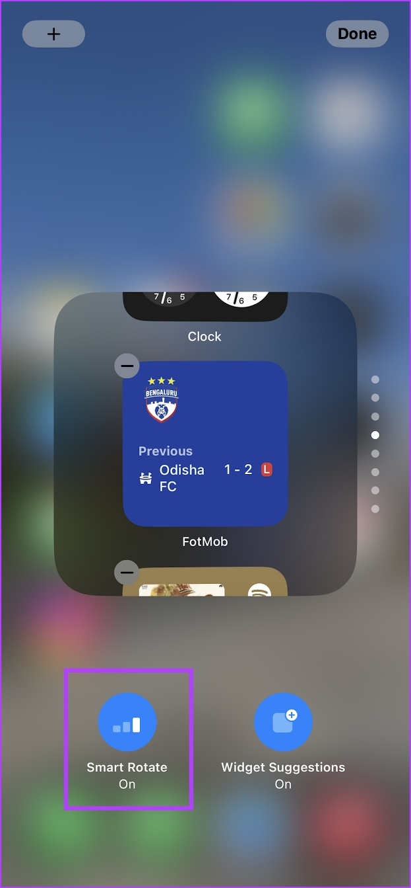
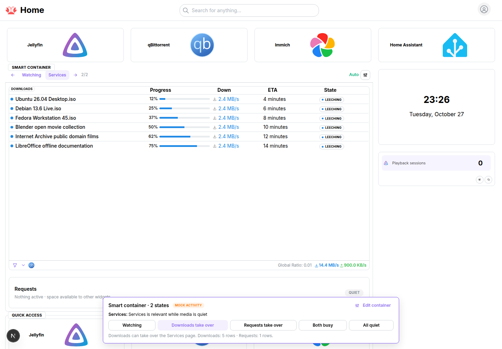

# Adaptive containers: research and prototype brief

Researched 2026-10-27 before issue creation. This is a throwaway design artifact, not production documentation. Two GPT-6.1 Sol agents at extra-high reasoning independently audited Homarr source and first-party external references.

**Current question, clarified after review:** Can one smart container select a relevant state, allow manual paging, and distribute space between that state's widgets according to activity and content volume?

**Current scope:** Demonstrate state selection and content-driven allocation together inside native Homarr. The earlier hiding-only MVP recommendation below records the original research framing; the combined specification in [#7393](https://github.com/homarr-labs/homarr/issues/7393) supersedes that narrower scope. No production relevance algorithm or implementation has been approved.

The supplied conversation is motivation. Its reported contributor implementation was not provided for source review. The screenshot is an iPhone editing reference, not a Homarr design or an instruction source.



## Homarr source audit

Source checkout: `a76c72e2e53334206234e50ae644445dcd2299ac`, inspected in `/tmp/homarr-adaptive-containers`. This is research, not a production implementation. No tests were added or run. Vocabulary follows `GLOSSARY.md`: a container is a Section; a placed widget is an Item; Base/Mobile are Layouts. The only ADR concerns bounded Board permission writes and does not mandate layout behavior.

## What exists

- **Containers already have Edit.** In board edit mode, their menu offers Edit, Move/resize, and Remove. Edit opens `ContainerEditModal`, with title, label, collapsible, open all Apps, scrollable, CSS classes, and border color. Its controlled form submits changes and closes; it has no change callback, live preview, adaptive setting, or reset control. Container actions update only the matching section's options in the board query cache. [Menu](https://github.com/homarr-labs/homarr/blob/a76c72e2e53334206234e50ae644445dcd2299ac/apps/nextjs/src/components/board/sections/container/container-menu.tsx#L19-L70), [modal](https://github.com/homarr-labs/homarr/blob/a76c72e2e53334206234e50ae644445dcd2299ac/apps/nextjs/src/components/board/sections/container/container-edit-modal.tsx#L12-L74), [draft update](https://github.com/homarr-labs/homarr/blob/a76c72e2e53334206234e50ae644445dcd2299ac/apps/nextjs/src/components/board/sections/container/container-actions.ts#L15-L32).
- **Options belong to the Section, geometry to each Layout.** Container options have defaults and no activity/height-mode field. Its layout entries have positive integer width/height, nonnegative integer x/y, and `parentSectionId`. Options are shared by all layouts. A default-off schema option can travel through existing serialized options without a dedicated DB column; exact schema/serialization changes are still required. [Schema](https://github.com/homarr-labs/homarr/blob/a76c72e2e53334206234e50ae644445dcd2299ac/packages/validation/src/shared.ts#L24-L102), [insert serialization](https://github.com/homarr-labs/homarr/blob/a76c72e2e53334206234e50ae644445dcd2299ac/packages/api/src/router/board.ts#L1755-L1784), [update serialization](https://github.com/homarr-labs/homarr/blob/a76c72e2e53334206234e50ae644445dcd2299ac/packages/api/src/router/board.ts#L1875-L1887).
- **Saving board edits is explicit.** The edit toggle submits the full board, closes only on success, and invalidates/refetches it. The layout-settings editor additionally has confirmed discard. Demo mode discards changes by invalidating the query. The ordinary container modal's Cancel currently discards its unsubmitted form because no board update has occurred. [Header actions](https://github.com/homarr-labs/homarr/blob/a76c72e2e53334206234e50ae644445dcd2299ac/apps/nextjs/src/app/%5Blocale%5D/boards/(content)/_header-actions.tsx#L93-L184).
- **Modify access remains the authorization boundary.** The board Edit and Settings actions check `hasChangeAccess`. `board.saveBoard` is protected and verifies modify access before validation/persistence. It treats omitted Items/Sections as removals, so saving a filtered adaptive view would delete content. [UI access](https://github.com/homarr-labs/homarr/blob/a76c72e2e53334206234e50ae644445dcd2299ac/apps/nextjs/src/app/%5Blocale%5D/boards/(content)/_header-actions.tsx#L42-L63), [server authorization and removal diff](https://github.com/homarr-labs/homarr/blob/a76c72e2e53334206234e50ae644445dcd2299ac/packages/api/src/router/board.ts#L1703-L1750).

## Existing display and layout seam

`SectionGrid` already separates saved `placements` from view-only `displayPlacements` for collapsed containers, then maps those display coordinates onto rendered Items/Sections. Editor registration explicitly carries both `placements: displayPlacements` and `transactionPlacements: placements`. This is the closest seam for adaptive presentation; it must retain all persisted Items and all layout entries. [Placement construction and display projection](https://github.com/homarr-labs/homarr/blob/a76c72e2e53334206234e50ae644445dcd2299ac/apps/nextjs/src/components/board/sections/grid/section-grid.tsx#L82-L161), [editor registry](https://github.com/homarr-labs/homarr/blob/a76c72e2e53334206234e50ae644445dcd2299ac/apps/nextjs/src/components/board/sections/grid/section-grid.tsx#L269-L287).

Collapse reflow preserves gaps in unrelated horizontal columns by shifting only through intervals removed above a neighbor, and resolves collisions deterministically. A generic `reflowVerticalLayout` instead compacts every item from row zero. Prefer adapting the targeted removed-space algorithm for hiding/height reductions, rather than unexpectedly removing intentional gaps across the whole board. Existing `getCollapsedDisplayLayout` cannot receive a zero height: it explicitly rejects nonpositive heights, and normal placement normalization requires positive integer height. Hidden entries need exclusion from the display geometry plus retained activity ownership, or a dedicated projection that supports removed bounds. [Reflow](https://github.com/homarr-labs/homarr/blob/a76c72e2e53334206234e50ae644445dcd2299ac/apps/nextjs/src/components/board/layout/reflow.ts#L27-L109), [targeted gap preservation](https://github.com/homarr-labs/homarr/blob/a76c72e2e53334206234e50ae644445dcd2299ac/apps/nextjs/src/components/board/layout/reflow.ts#L127-L177), [positive geometry](https://github.com/homarr-labs/homarr/blob/a76c72e2e53334206234e50ae644445dcd2299ac/apps/nextjs/src/components/board/layout/geometry.ts#L49-L72).

Current container fitting is **grid fitting, not intrinsic content height**. A grid track's logical pitch is 212 pixels. Items are absolutely positioned and sized by their grid footprint. Non-scrollable container minimum heights derive recursively from saved child `yOffset + height`; scrollable containers retain their viewport while content overflows. A container also retains `requestedRowCount`, and its inner row pitch adapts to its allocated height. Removing an inner card does not automatically shrink its outer Section footprint or enlarge a sibling. [Constants](https://github.com/homarr-labs/homarr/blob/a76c72e2e53334206234e50ae644445dcd2299ac/apps/nextjs/src/components/board/layout/constants.ts#L1-L10), [absolute footprint](https://github.com/homarr-labs/homarr/blob/a76c72e2e53334206234e50ae644445dcd2299ac/apps/nextjs/src/components/board/layout/geometry.ts#L18-L46), [row and scroll rules](https://github.com/homarr-labs/homarr/blob/a76c72e2e53334206234e50ae644445dcd2299ac/apps/nextjs/src/components/board/sections/grid/section-grid.tsx#L162-L230), [recursive minima](https://github.com/homarr-labs/homarr/blob/a76c72e2e53334206234e50ae644445dcd2299ac/apps/nextjs/src/components/board/sections/grid/section-grid.tsx#L427-L480).

The read renderer keys content by stable Item ID and maintains deterministic position order. The board portal host keeps runtime state by Item ID until the Item is actually removed from the board. Advanced Focus portals the same widget surface between compact and expanded hosts. Adaptive presentation should preserve these identities, pin the active/focused Item until interaction ends, and avoid moving focused controls into a hidden/inert subtree. [Content order and keys](https://github.com/homarr-labs/homarr/blob/a76c72e2e53334206234e50ae644445dcd2299ac/apps/nextjs/src/components/board/sections/content.tsx#L13-L48), [runtime ownership](https://github.com/homarr-labs/homarr/blob/a76c72e2e53334206234e50ae644445dcd2299ac/apps/nextjs/src/components/board/sections/grid/grid-portal-host.tsx#L22-L46), [surface movement](https://github.com/homarr-labs/homarr/blob/a76c72e2e53334206234e50ae644445dcd2299ac/apps/nextjs/src/components/board/items/item-content.tsx#L269-L308).

Mobile is an ordinary selected responsive Layout, not a separate widget implementation. `useSectionItems` resolves each Item/Section from the current layout and its current parent ID; missing placements are omitted. An adaptive option stored on the Section therefore applies wherever that Section is placed, but geometry must be projected independently for each layout. Nested containers recursively call `SectionGrid`; do not flatten their children or transfer Items between parents. [Layout selection](https://github.com/homarr-labs/homarr/blob/a76c72e2e53334206234e50ae644445dcd2299ac/packages/boards/src/context.tsx#L73-L87), [breakpoint algorithm](https://github.com/homarr-labs/homarr/blob/a76c72e2e53334206234e50ae644445dcd2299ac/packages/boards/src/layout-selection.ts#L8-L21), [layout-local children](https://github.com/homarr-labs/homarr/blob/a76c72e2e53334206234e50ae644445dcd2299ac/apps/nextjs/src/components/board/sections/use-section-items.ts#L27-L50), [nested grid](https://github.com/homarr-labs/homarr/blob/a76c72e2e53334206234e50ae644445dcd2299ac/apps/nextjs/src/components/board/sections/container-section.tsx#L232-L252).

## Currently playing activity evidence

The current widget kind is `mediaServer`. Its query input is selected `integrationIds` plus `showOnlyPlaying`; the latter defaults true. Its query refresh policy is ten seconds. The component owns the query hook and flattens the returned sessions into rows. [Definition](https://github.com/homarr-labs/homarr/blob/a76c72e2e53334206234e50ae644445dcd2299ac/packages/widgets/src/media-server/index.ts#L8-L26), [query and flattening](https://github.com/homarr-labs/homarr/blob/a76c72e2e53334206234e50ae644445dcd2299ac/packages/widgets/src/media-server/component.tsx#L170-L211), [central refresh policy](https://github.com/homarr-labs/homarr/blob/a76c72e2e53334206234e50ae644445dcd2299ac/packages/widgets/src/refetch-intervals.ts#L8-L19), [policy installation](https://github.com/homarr-labs/homarr/blob/a76c72e2e53334206234e50ae644445dcd2299ac/apps/nextjs/src/app/%5Blocale%5D/_client-providers/trpc.tsx#L153-L173).

An empty array is not sufficient evidence of inactivity:

1. Before a result, the component substitutes `[]` for absent data.
2. Each failed integration is represented as `sessions: []` with an error; partial success returns these entries alongside good data. All integrations failing throws a query error.
3. Existing query-state helpers deliberately preserve cached data on transient errors, while throwing forbidden access and errors without cached data. A previously empty cached result plus current error must show an error/unknown state, not remain silently hidden.
4. No selected integration is a configuration error in the shared Item wrapper. The middleware also rejects missing or inaccessible integration selections. Do not query an empty selection and interpret its empty response as inactivity.

[Initial data handling](https://github.com/homarr-labs/homarr/blob/a76c72e2e53334206234e50ae644445dcd2299ac/packages/widgets/src/media-server/component.tsx#L177-L182), [per-integration fallback](https://github.com/homarr-labs/homarr/blob/a76c72e2e53334206234e50ae644445dcd2299ac/packages/api/src/router/widgets/media-server.ts#L18-L44), [all-failure handling](https://github.com/homarr-labs/homarr/blob/a76c72e2e53334206234e50ae644445dcd2299ac/packages/api/src/settle-integrations.ts#L23-L66), [cached data/error contract](https://github.com/homarr-labs/homarr/blob/a76c72e2e53334206234e50ae644445dcd2299ac/packages/widgets/src/common/query-state.ts#L12-L21), [configuration guard](https://github.com/homarr-labs/homarr/blob/a76c72e2e53334206234e50ae644445dcd2299ac/apps/nextjs/src/components/board/items/item-content.tsx#L479-L510), [access middleware](https://github.com/homarr-labs/homarr/blob/a76c72e2e53334206234e50ae644445dcd2299ac/packages/api/src/middlewares/integration.ts#L154-L188).

For Jellyfin, `showOnlyPlaying` actually means `NowPlayingItem` exists; paused media still has that property and is retained. Its playback state is separately mapped to paused/playing. Recommend defining inactive as **no displayed sessions after the widget's configured server filter**, so paused sessions remain relevant. Do not silently reinterpret paused as inactive. The advanced view's search is presentation only and must not change activity. [Jellyfin filtering/state](https://github.com/homarr-labs/homarr/blob/a76c72e2e53334206234e50ae644445dcd2299ac/packages/integrations/src/jellyfin/jellyfin-integration.ts#L150-L190), [advanced search](https://github.com/homarr-labs/homarr/blob/a76c72e2e53334206234e50ae644445dcd2299ac/packages/widgets/src/media-server/component.tsx#L209-L212).

The media handler uses the shared integration response cache. Default freshness is ten seconds; this handler does not opt into stale-on-error fallback. Its endpoint discards the handler timestamp, so exact upstream freshness is unavailable in its returned shape. A bounded initial policy can use query success/error and `dataUpdatedAt`, with a documented observation freshness window, rather than claim push/live certainty. [Handler](https://github.com/homarr-labs/homarr/blob/a76c72e2e53334206234e50ae644445dcd2299ac/packages/request-handler/src/media-server.ts#L7-L19), [cache defaults](https://github.com/homarr-labs/homarr/blob/a76c72e2e53334206234e50ae644445dcd2299ac/packages/request-handler/src/lib/request-handler.ts#L28-L37), [fresh cache rules](https://github.com/homarr-labs/homarr/blob/a76c72e2e53334206234e50ae644445dcd2299ac/packages/request-handler/src/lib/request-handler.ts#L255-L281), [timestamp discarded](https://github.com/homarr-labs/homarr/blob/a76c72e2e53334206234e50ae644445dcd2299ac/packages/api/src/router/widgets/media-server.ts#L24-L33).

**Hidden Items need an activity owner that stays mounted.** Filtering `SectionContent` alone removes the component that owns `useQuery`. It would no longer keep refreshing merely because the board still stores the Item. Keep a small controller/query observer per eligible Item outside its optional visual body, using the same query input/cache, or keep that controller mounted inside a stable Item shell while hiding only its visual body. Merely subscribing to cache events is insufficient when no observer performs future fetches. This is a lifecycle implication of the query hook's current ownership, not an existing Homarr activity API. Verify the actual observer/refetch choice against current TanStack docs during implementation.

Generic Stats supports Jellyfin, but its current provider exposes only **Playback sessions** (`getCurrentSessionsAsync({showOnlyPlaying: false}).length`). More space cannot create additional Jellyfin metrics. A prototype can show more *configured content*, but additional service metrics are separate integration work. [Jellyfin Stats adapter](https://github.com/homarr-labs/homarr/blob/a76c72e2e53334206234e50ae644445dcd2299ac/packages/integrations/src/stats/existing.ts#L245-L251), [Stats options](https://github.com/homarr-labs/homarr/blob/a76c72e2e53334206234e50ae644445dcd2299ac/packages/widgets/src/stats/index.ts#L9-L38).

## Original bounded MVP recommendation (superseded scope)

These are proposals derived from the source, not current behavior.

1. Add one default-off container option: **Hide inactive widgets**. Initially only direct `mediaServer` Items can report inactivity. Unsupported Items always stay visible. Nested container Sections stay visible and independently evaluate their own options; no recursive relevance inference.
2. Use explicit activity states: `active`, `inactive`, `unknown`, `error`, `unsupported`. Hide only a complete, successful, fresh empty result for a configured Item, without per-integration failures. Any sessions mean active; partial failure or current query error must remain visible with existing error UI. Initial/loading/expired state remains visible. A background refresh can retain a fresh last successful decision until success, failure, or expiry.
3. Project read-only display geometry inside that container; retain width, Item identity, parent, saved height/order, and every saved layout entry. Close only the holes introduced by inactive Items, preserving intentional unrelated gaps. Do not call `updateBoard`, layout commit, or `saveBoard` from activity changes.
4. Keep the controller polling while hidden, at existing media refresh cadence and respecting demo/background behavior. Deduplicate identical query inputs through the existing query client; clean up observers when the Item actually leaves the relevant layout/board.
5. Board edit mode shows all configured Items at saved geometry. Adaptive preview can be explicit in the modal, with inactive Items represented by discoverable placeholders in the editing view. Never let a polling change alter an active drag/resize or keyboard transaction.
6. An all-inactive container keeps a small stable **No active widgets** state within its saved outer footprint. This avoids disappearing configuration entry points; edit mode restores every Item. Whole-container auto-hide, outer shrink, and ancestor reflow are a separate policy.
7. Enhance existing Edit with a local preview overlay/snapshot: control changes preview immediately; Apply updates the board draft; Cancel/close/Escape discards that preview; Reset restores defaults in the draft preview and Cancel still restores the opening value. Avoid rolling back the entire board query snapshot, which could erase unrelated concurrent draft edits. Only the final board Save persists configuration.

## Follow-up phases: fitting, reclaiming space, and smart stacks

**Content-height fitting** must name its scope. Fitting an Item's intrinsic content, shrinking a container's outer Section footprint, and expanding another Item into free space are three different operations. A `9 × 1` sibling requires actual available grid width/height and collision-free placement, not just clipping empty pixels. Keep manual sizing as the default and introduce explicit fitting/expansion modes. Start with content-aware hints for a small supported set; generic DOM measurement of `h="100%"`/scroll areas creates circular allocated-height measurements. Convert any measured physical height through canvas scale, ancestor content scale, row scale, headers/insets, then apply minimum/maximum row bounds. The existing constant/sizing paths above show why a global ResizeObserver alone will not solve this.

For **reclaim inside a fixed container**, allow an explicitly configured fallback Item to grow within the saved container budget using display geometry only; restore original saved sizes when media returns. Expanding generic Stats must use its existing configured entries. For **outer shrink/reflow**, propagate display bounds bottom-up through nested Sections, then reflow only overlapping neighbors at each ancestor; root lanes have their own viewport/fill behavior. Treat scrollable/collapsible interaction and all-empty minimums as explicit decisions. Preserve saved expanded dimensions across toggles and reloads.

For a later **smart stack**, add explicit membership, deterministic priority/relevance and fallback rules, visible stack count and manual navigation, and freeze selection while a person focuses/opens/interacts with an Item. Add minimum dwell/grace to prevent flicker; a prototype can use a short, adjustable empty grace to validate this. Rank only after known activity, never infer inactivity from numeric zero or missing DOM. Keep stable Item IDs and one active presentation of each Item. Avoid automatic rotation as an MVP dependency.

Related regression checks supplied by the coordinating research: [#7094](https://github.com/homarr-labs/homarr/issues/7094)/[#7096](https://github.com/homarr-labs/homarr/pull/7096) collapse gaps/overlap, [#7178](https://github.com/homarr-labs/homarr/issues/7178)/[#7232](https://github.com/homarr-labs/homarr/pull/7232) overflow/footer gap, and [#7363](https://github.com/homarr-labs/homarr/pull/7363) saved container dimensions. These are related constraints, not evidence that adaptive containers already exist. The coordinator owns tracker verification and duplicate assessment.

## Concrete implementation seams

| Concern | Owning seam |
| --- | --- |
| Default-off container configuration | `packages/validation/src/shared.ts` container options/defaults; normal full-board serialization |
| Form, preview/apply/cancel/reset | Existing `container-edit-modal.tsx`, `container-menu.tsx`, `container-actions.ts`; add separate preview overlay/context rather than persistent draft layout writes |
| Activity contract and media interpretation | `packages/widgets` capability/definition and media-server query helper; reusable logic stays out of app-only code |
| Activity observer lifetime | Board/Section-level controller outside optional visual Item bodies, using `@homarr/api/client`; board runtime host already provides stable identity storage |
| Read-only projection / targeted hole closing | `SectionGrid` saved vs display placement seam and pure `layout/reflow.ts` helper |
| Render visibility / accessibility | `SectionContent`, `FixedGridItem`, focus/advanced-focus runtime; preserve key and isolate hidden/inert visual content |
| Persistence and permissions | Existing `board.saveBoard` modify checks; no persistence on activity changes |
| Future content sizing | Explicit Item sizing capability + grid row conversion; separate from visibility and independent of extra Jellyfin metrics |

Suggested manual/prototype scenarios: active → empty → active; paused Jellyfin session; two integrations with one failing; all failing; initial loading; stale empty then failure; missing integration; unsupported Item; all eligible Items inactive; two Items sharing a query; focus/Advanced Focus while activity changes; edit/drag during refresh; cancel/reset; Base↔Mobile layout switch; nested and scrollable/collapsible Sections; reload restores saved sizes with no layout writes.


## External primary-source research

Researched 2026-10-27. This note covers external precedent and accessibility. It does not verify existing Homarr behavior. The supplied iPhone screenshot and quoted conversation establish the requested direction; the sources below establish platform facts.

## Apple precedent: verified behavior

- **Smart Rotate and Widget Suggestions are separate controls.** Smart Rotate promotes a stack member with timely, relevant information. Widget Suggestions proposes widgets not already in the stack. Apple describes context and app-use patterns as inputs. These are separate capabilities, so a Homarr control that only chooses among configured children should not imply automatic widget discovery or insertion. [Apple: Increasing the visibility of widgets in Smart Stacks](https://developer.apple.com/documentation/widgetkit/widget-suggestions-in-smart-stacks)
- **People retain control over membership and order.** Apple's support documentation describes Edit Stack, reordering, and separate on/off controls for Smart Rotate and Widget Suggestions. It describes stacks as saving Home Screen space. [Apple Support: How to add and edit widgets on your iPhone](https://support.apple.com/en-us/118610)
- **Manual browsing coexists with relevance.** Apple's strategy documentation explicitly describes swiping through stacks manually alongside Smart Rotate. The screenshot's paging dots are therefore useful visual inspiration, but the prototype needs keyboard-operable selectors as well. [Apple: Developing a WidgetKit strategy](https://developer.apple.com/documentation/widgetkit/developing-a-widgetkit-strategy/)
- **Relevance has a time window.** `TimelineEntryRelevance` provides a score and duration, relative to entries in the same provider's current/past timelines. During that window, WidgetKit *may* promote the widget; relevance is not its only input. This is not a published cross-app ranking formula or a guarantee that the largest submitted number wins. [Apple: TimelineEntryRelevance](https://developer.apple.com/documentation/widgetkit/timelineentryrelevance)
- **Ineligibility differs from low rank.** Apple documents non-positive relevance as excluding promotion, and requires a consistent scale across a provider's timelines. It also documents rate limits for rotations/suggestions, without specifying a general cadence suitable for Homarr. These facts support separating eligibility, relevance, and switching policy; they do not determine Homarr's thresholds. [Apple: Increasing the visibility of widgets in Smart Stacks](https://developer.apple.com/documentation/widgetkit/widget-suggestions-in-smart-stacks)

Apple's documentation covers multiple platforms. In particular, it distinguishes iPhone/iPad timeline scores from watchOS relevance APIs. Do not generalize watchOS pinning or `relevance()` behavior to the supplied iPhone example. [Apple: Increasing the visibility of widgets in Smart Stacks](https://developer.apple.com/documentation/widgetkit/widget-suggestions-in-smart-stacks)

## Accessibility: requirements and guidance

**Normative WCAG:** Success Criterion 2.2.2 requires a way to pause, stop, hide, or control the frequency of qualifying automatically updating information presented alongside other content, unless essential. The five-second allowance belongs to moving/blinking/scrolling content; it does not exempt short automatic content updates. [WCAG 2.2, SC 2.2.2](https://www.w3.org/TR/WCAG22/#pause-stop-hide), [W3C explanatory guidance](https://www.w3.org/WAI/WCAG22/Understanding/pause-stop-hide)

**W3C carousel implementation guidance:** Provide manual previous/next navigation and an explicit stop/restart control for automatic rotation. Stop when keyboard focus enters; resume only on an explicit user request. Also stop on pointer hover. Keep focus on the activated navigation control. Give selectors meaningful names and keep hidden content out of the exposed reading/navigation experience. The pattern distinguishes live-region behavior during automatic rotation from manual selection. This is authoring guidance, not a claim that every relevance-based container is necessarily a carousel. [WAI-ARIA APG: Carousel pattern](https://www.w3.org/WAI/ARIA/apg/patterns/carousel/)

**Focus order:** SC 2.4.3 requires sequential focus order to preserve meaning and operation. W3C notes that order need not always equal visual position, but should remain understandable to sighted keyboard and screen-reader users. A conservative Homarr policy is to postpone automatic replacement/collapse while a child contains focus, so the current interaction is not removed. This policy is a recommendation derived from the guidance, not wording prescribed by the criterion. [W3C: Understanding Focus Order](https://www.w3.org/WAI/WCAG22/Understanding/focus-order.html)

**Reduced motion:** `prefers-reduced-motion: reduce` expresses a preference to remove or replace nonessential motion. The cited Media Queries Level 5 document is a Working Draft. For Homarr, use an immediate content change instead of sliding, zooming, or animated height collapse when this preference is active. Reduced animation does not replace controls over automatic content changes. [W3C Media Queries Level 5, reduced motion](https://www.w3.org/TR/mediaqueries-5/#prefers-reduced-motion)

## Jellyfin semantics: relevant first-party evidence

Jellyfin's session model separately exposes `NowPlayingItem`, `LastActivityDate`, `LastPlaybackCheckIn`, and `PlayState`. Its `IsActive` property examines session controllers; it does not check whether media is playing. Therefore a logged-in or active client session is insufficient evidence for a "currently playing" eligibility rule. [Jellyfin: SessionInfo source](https://github.com/jellyfin/jellyfin/blob/master/MediaBrowser.Controller/Session/SessionInfo.cs)

Playback progress handling retains/updates the current item and separately records `PlayState.IsPaused`; stopping playback removes the current item and resets play state. A paused session can therefore still have a current item. The issue must explicitly decide whether paused playback is eligible rather than equating item presence with active playback. These observations are from upstream `master`, not a promise about every deployed version or Homarr's adapter. [Jellyfin: SessionManager source](https://github.com/jellyfin/jellyfin/blob/master/Emby.Server.Implementations/Session/SessionManager.cs), [Jellyfin: PlayerStateInfo source](https://github.com/jellyfin/jellyfin/blob/master/MediaBrowser.Model/Session/PlayerStateInfo.cs)

## Original research recommendations (before clarification)

The following are proposed Homarr policies, not verified Apple behavior or existing Homarr capabilities:

The original recommendation scoped the first deliverable to hiding confirmed-inactive children, with relevance selection and height as follow-ups. The user's clarification supersedes that split for the prototype: state selection and within-state allocation must be demonstrated together. The safeguards below remain research inputs, rather than a selected production design.

1. **Make eligibility, ranking, and presentation distinct.** A media child can be ineligible after a successful empty result, relevant while playing, and lower priority while paused. Children without an explicit activity signal should remain available under a neutral policy. Loading, errors, stale data, and unsupported signals must remain distinct from confirmed inactivity.
2. **Begin with configured children.** Offer automatic selection among the children users chose. Reserve widget suggestions/insertion for a separate future capability with separate consent and settings.
3. **Select on meaningful state changes.** Relevance changes or expiry can change the selected child; do not cycle through children on a timer. A manual "Advance clock" demonstration should advance simulated relevance expiry without enabling a timed carousel. Keep the incumbent on ties, retain manual choice until the user resumes automatic selection, and avoid oscillation with an explicit grace/cooldown policy. Any numerical scores or durations in a prototype are illustrative defaults.
4. **Keep the container's controls stable.** An Edit container action should expose settings beside a live preview. Preview changes should not replace the settings controls or move focus. In edit mode, retain access to every configured child, including those hidden in the normal board view.
5. **Keep manual navigation and automatic-selection control reachable.** A focused or manually selected child should remain readable. For a stack-like presentation, follow the APG control/focus behavior above. Respect reduced motion and expose selected item/count and reasons without repeatedly announcing every background update.
6. **Choose the all-inactive policy explicitly.** A compact placeholder preserves discoverability; a chosen fallback can show stats; collapsing the container reclaims space but can move surrounding content. Keep these as separately specified outcomes. Automatic item height and board reflow are a later design/architecture decision, not a consequence already established by Apple's stack pattern.

Useful prototype cases: fresh playing media; paused-only sessions; successful empty response; loading; service failure; stale data; a widget with no activity signal; tied relevance; keyboard focus inside a child; manual selection followed by changing activity; reduced motion; and an all-inactive container. These are manual review scenarios, not a request to add or run automated tests.

## Prototype capture and decision record

Issue: [#7393](https://github.com/homarr-labs/homarr/issues/7393). The research above was committed at `2bf346f99` before the issue was created and before prototype code was written.

The standalone HTML was rejected because it did not use Homarr. The later separate A/B/C variants also missed the combined behavior. Both are superseded; their captures do not validate this design.

The replacement uses Homarr's existing `/boards/adaptive-containers-prototype` route, header, theme, responsive grid, and native widgets. **Watching** contains Currently playing; **Services** contains Downloads and Requests. Playback selects Watching, otherwise Services. Within the selected page, children compete for six rows: busy items grow, idle siblings contract. Manual paging holds until Resume. Stats, Clock, and App widgets remain outside this container.

```sh
mise exec -- bun run prototype:adaptive-containers
```

The [README](../../apps/nextjs/src/components/board/sections/__prototype__/README.md) describes setup and controls. Route-scoped typed fixtures supply native query responses; other procedures use the real API and dedicated scratch database. Inputs support 0–12 counts. Reclaim unused space defaults on; its Apply/Cancel preview remains in memory.



**Manual evidence from the native board:**

- **Watching:** four native session rows load in a six-row container. [Capture](assets/adaptive-containers-smart-watching.png)
- **Downloads take over:** six native jobs receive five rows; quiet Requests gets one. **Requests take over** reverses this: five request cards receive five rows; Downloads gets one. [Requests capture](assets/adaptive-containers-smart-requests.png)
- **Both busy:** four downloads and four requests share three rows each. [Capture](assets/adaptive-containers-smart-both.png)
- **All quiet:** two compact named summaries use one row each. The outer container shrinks to two rows and its neighbor moves from row seven to three. [Capture](assets/adaptive-containers-smart-idle.png)
- **Live sizing and control:** changing downloads from six to one produces one native job, allocations of two plus one rows, outer height three, and neighbor row four. Manually choosing Watching while idle holds through Downloads take over; Resume selects Services.
- **Native editing:** all saved placements return: container six rows; media three; Downloads two at row three; Requests one at row five; neighbor row seven. Activity does not write saved geometry.
- **Cancel:** previewing fixed outer space, receiving the All quiet activity update, then cancelling restores reclamation and the two-row container while retaining the newer quiet data.
- **Mobile:** the real 390px Mobile layout uses three columns, document width stays 390px, and the 44px toolbar fits all controls with working manual paging. Final browser checks reported no unhandled errors. [Capture](assets/adaptive-containers-native-mobile.png)

Three GPT-6.1 Sol agents at Extra High supported context/grid hooks, Mantine controls, fixture transport, and source review. Validation used manual browsing and targeted lint, formatting, and diff checks; no tests or broad builds ran.

**Limits and decision:** no production design is selected. Membership and priority are fixed; allocation uses count-based hints, not generic relevance or DOM measurement. Synchronous successful fixtures do not verify real freshness, failures, authorization, or persistence. Nesting, side lanes, and the wider board lifecycle remain unverified.
