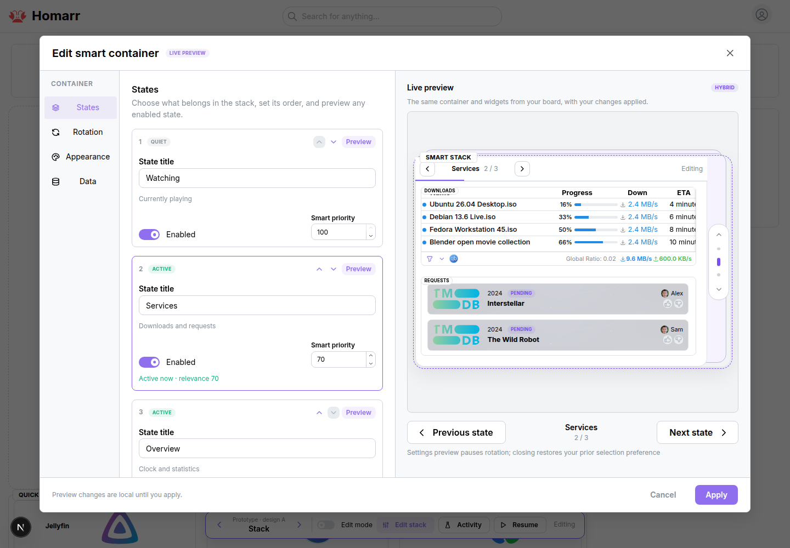

# iPhone-inspired smart stack: prototype design record

2026-10-29 · `feat/prototype-smart-stack` · [Issue #7393](https://github.com/homarr-labs/homarr/issues/7393)

**Design question:** can Homarr combine stack-like manual browsing, timed and activity-based page selection, and competition for bounded space while keeping its real widgets and a complete editing experience?

This is a separate native experiment. The earlier combined-container prototype remains preserved on `feat/prototype-adaptive-containers`; its [research](adaptive-containers.md) supplies context, not validation of this new comparison. No production design has been selected.

The existing board route hosts three pages: **Watching** contains Currently playing; **Services** contains Downloads and Requests; **Overview** contains a native Clock and Stats. Top App tiles, the side Clock, and Quick access remain normal board content. Children share a six-row budget. The default outer frame stays stable; optional reclaim follows smaller allocations, with three-row minimums for Reel/Inspector navigation.

Three presentations share this model:

| Variant           | Design question                                                   |
| ----------------- | ----------------------------------------------------------------- |
| **A · Stack**     | Does one focused state with vertical navigation feel direct?      |
| **B · Reel**      | Do glimpses of neighboring states improve discoverability?        |
| **C · Inspector** | Does an enabled-state tray make membership and selection clearer? |

The full custom **Edit smart container** modal uses native Mantine controls and moves the five existing widget bodies into a real preview. **States** edits labels, order, enabled pages, and priorities; **Rotation** configures modes and pauses; **Appearance** changes the preset, accent, transition, and reclaim setting; **Data** supplies scenarios/counts. Tabs are vertical on desktop and horizontal on phones. Preview paging sits below the content, with Apply/Cancel fixed in the footer.

| Mode       | Intended behavior                                                                                 |
| ---------- | ------------------------------------------------------------------------------------------------- |
| **Manual** | Changes pages only through navigation.                                                            |
| **Timed**  | Cycles enabled order at the configured interval, optionally skipping inactive pages.              |
| **Smart**  | Promotes the highest-priority relevant page on activity/priority changes; retains ties; no timer. |
| **Hybrid** | Combines timed paging and activity-driven promotion. Default: 12 seconds.                         |

Manual browsing holds until Resume. Editing, focused content, hidden tabs, and configured hover pauses freeze rotation. Apply/Cancel preserve incoming counts and any opening manual hold. Automatically enabled Smart/Hybrid selection reconciles current activity/priority on close; Timed restores its opening page/countdown, with a reset when an applied mode/interval changes. Cancel also restores the opening title/settings and design URL, including pending variant navigation.

**Manual desktop evidence:** all three designs render; the board contains 14 native widget bodies; modal preview moves five without duplication. Timed rotation advances at five seconds and hover holds it. Smart promotion, manual hold/Resume, Hybrid timer/activity changes, state reorder, Cancel restoration with retained counts, and the applied-interval countdown reset were exercised. A Smart update received during hover stayed deferred until pointer exit; a rail wheel gesture changed state with default scrolling cancelled and board scroll position unchanged.

**Manual phone evidence:** at 390×844, the modal fits at 351×824 and document width stays 390px. Preview and settings scroll remain reachable; Apply/Cancel stay visible. Horizontal tabs work, state reorder applies, and the body count remains 14 overall with five in the modal. Enabling reclamation for quiet Services reduced the stack to 250px while keeping document width at 390px. These desktop/phone observations come from the coordinating agent's browser checks.

Captures: [A · Stack](assets/iphone-smart-stack-A.png), [B · Reel](assets/iphone-smart-stack-B.png), [C · Inspector](assets/iphone-smart-stack-C.png), [Rotation](assets/iphone-smart-stack-rotation.png), [Phone preview](assets/iphone-smart-stack-phone-editor.png), [Phone settings](assets/iphone-smart-stack-phone-settings.png).

The development board uses typed fixture transport for native media, downloads, requests, and Stats queries; other procedures use the real scratch API/database. Counts and priorities are explicit inputs, not DOM measurement or Apple's algorithm. Page membership and overlapping fixture positions are authored for the experiment. Real upstream failures, authorization, freshness, persistence, global layout editing, nesting, and side lanes remain unverified. No automated tests or builds ran; validation used targeted lint/formatting and manual interaction checks.

Run and control instructions: [prototype README](../../apps/nextjs/src/components/board/sections/__prototype__/README.md).
